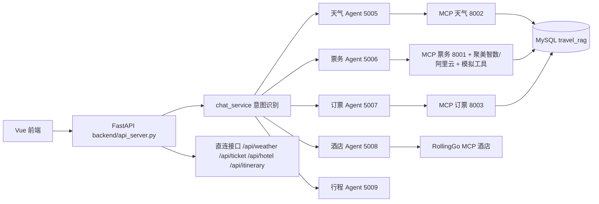

# SmartVoyage 项目开发指南

## 1. 项目简介

SmartVoyage 是一个基于 A2A + MCP + LangChain 的旅行智能助手，提供：

- 天气查询（和风天气：官方 LocationID + 全国城市经纬度兜底）
- 火车/高铁票查询（聚美智数/阿里云真实余票，可选）
- 火车票与酒店沙箱预订（虚拟订单，不产生真实扣款/出票）
- 酒店查询（RollingGo 真实接口）
- 多日行程规划（整合天气、交通、酒店）
- Web 对话、独立查询页面、执行轨迹与跨消息会话记忆

当前版本以“火车/高铁 + 酒店 + 天气 + 行程编排”为主，机票和演出暂不支持。

## 2. 技术架构

- Python 3.11+（推荐 `lang_env` 环境）
- FastAPI：REST API（`backend/`）
- python-a2a：A2A Agent 协议（`agents/`）
- MCP：工具服务（`mcp_servers/`）
- LangChain + 阿里云 DashScope：意图识别、SQL 生成、行程正文生成
- Vue3 + Vite：前端（`web/`）
- MySQL：演示数据（车票、订单、天气兜底）
- RollingGo MCP：真实酒店数据
- 聚美智数/阿里云市场：真实火车票余票（可选，失败可降级）



## 3. 目录结构

```text
SmartVoyage/
├── backend/                  # FastAPI REST 服务
│   ├── api_server.py         # 全部 HTTP 接口
│   ├── chat_service.py       # 对话意图识别 + Agent 编排
│   ├── auth.py               # 用户认证、会话、订单持久化
│   ├── session_memory.py     # 跨消息会话记忆槽位
│   ├── trace_store.py        # 执行轨迹环形存储
│   ├── virtual_bookings.py   # 火车/酒店沙箱订单与虚拟占用
│   └── demo_reset.py         # 面试演示环境复位
├── core/                     # 公共模块
│   ├── config.py             # 配置加载（.env）
│   ├── create_logger.py      # 日志
│   └── main_prompts.py       # 提示词
├── agents/                   # A2A Agent 服务
│   ├── weather_server.py     # 天气查询（5005）
│   ├── ticket_server.py      # 票务查询（5006）
│   ├── order_server.py       # 订票（5007）
│   ├── hotel_server.py       # 酒店查询（5008）
│   └── itinerary_server.py   # 行程编排（5009）
├── mcp_servers/              # MCP 服务
│   ├── mcp_weather_server.py # 8002
│   ├── mcp_ticket_server.py  # 8001
│   ├── mcp_order_server.py   # 8003
│   └── mcp_hotel_server.py   # 8004
├── utils/                    # 公共工具
│   ├── china_cities.py       # 全国城市识别
│   ├── mock_travel_provider.py # 模拟火车/高铁与订票
│   ├── train_api_aliyun.py   # 聚美智数/阿里云真实余票适配
│   ├── hotel_provider.py     # RollingGo 酒店/房型适配与本地兜底
│   └── weather_resolver.py   # 城市名 -> 和风天气位置
├── web/                      # Vue3 前端
│   └── src/
│       ├── api.js            # 前端 API 封装
│       └── views/            # 天气/票务/酒店/行程/对话页面
├── tests/                    # 测试
├── scripts/                  # 启动/停止脚本
├── sql/                      # 数据库建表、示例数据与增量 migration
├── logs/                     # 运行日志（gitignore）
├── CLAUDE.md                 # 本文件
├── .env                      # 环境变量/密钥（gitignore）
├── .mcp.json                 # MCP 配置/RollingGo Key（gitignore）
├── docker-compose.yml
└── Dockerfile
```

## 4. 快速开始

环境要求：

```powershell
conda activate lang_env
pip install -r requirements.txt
```

启动数据库（可选，本地已有 MySQL 可跳过）：

```powershell
docker compose up -d mysql
```

启动整套 Web 服务：

```powershell
cd 项目根目录
.\scripts\start-web.ps1
```

停止：

```powershell
.\scripts\stop.ps1
```

访问地址：

- 前端：http://localhost:5173
- API：http://localhost:8080
- 健康检查：http://localhost:8080/api/health

## 5. 配置说明

### .env

| 变量 | 说明 |
| --- | --- |
| LLM_BASE_URL | 大模型接口地址 |
| LLM_API_KEY | 大模型密钥 |
| LLM_MODEL_NAME | 行程正文模型（默认 qwen3.7-plus） |
| LLM_FAST_MODEL | 意图识别/SQL 生成快速模型（默认 qwen-plus） |
| DB_HOST / DB_PORT / DB_USER / DB_PASSWORD / DB_NAME | MySQL 配置 |
| WEATHER_API_KEY | 和风天气密钥 |
| QWEATHER_API_HOST | 和风天气专属主机（如 mb4bjc3gtb.re.qweatherapi.com） |
| WEATHER_CACHE_TTL_SECONDS | 天气缓存秒数（默认 10800 = 3 小时） |
| DIRECT_CACHE_TTL_SECONDS | API 直连缓存秒数（默认 10800 = 3 小时） |
| ALIYUN_APPCODE / ALIYUN_TRAIN_API_URL | 聚美智数/阿里云真实余票配置（可选） |
| TRAIN_QUERY_SOURCE | aliyun=只查真实票源；auto=失败降级本地；local/db=只用本地数据 |
| TRAIN_CACHE_TTL_SECONDS | 真实余票短缓存秒数（默认 120） |
| TRAIN_RATE_MAX_PER_MINUTE | 真实余票每分钟限流（默认 12） |
| A2A_*_URL / MCP_*_URL | 各 Agent/MCP 服务地址（本地默认 localhost；Docker 部署填 compose 服务名） |
| A2A_*_PORT / MCP_*_PORT | 各服务端口（脚本启动时读取） |

### .mcp.json

```json
{
  "mcpServers": {
    "RollingGo-Hotel": {
      "type": "streamable-http",
      "url": "https://mcp.rollinggo.cn/mcp",
      "headers": { "Authorization": "Bearer your-key" }
    }
  }
}
```

注意：`.env` 和 `.mcp.json` 含密钥，禁止提交。

## 6. 核心数据流

### 6.1 对话流

用户输入 -> `/api/chat` -> 意图识别（LLM） -> 路由到对应 A2A Agent -> Agent 调用 MCP/外部接口 -> 返回结果 -> 摘要/直接返回。

### 6.2 独立页面流

前端页面直接调用 `/api/weather`、`/api/ticket`、`/api/hotel`、`/api/itinerary`，跳过意图识别，响应更快。

### 6.3 行程编排流

`ItineraryPlannerAssistant` 收到需求后：

1. 识别目的地、出发城市、日期、天数
2. 并发调用天气、去程票务、返程票务、酒店 Agent
3. 对车次做偏好筛选（卧铺晚间、高铁/飞机早到、返程下午回）
4. 将真实数据交给 LLM 生成多日行程
5. 任一数据源失败时降级为“暂不可用”，不中断整体行程

## 7. API 接口

| 方法 | 路径 | 说明 |
| --- | --- | --- |
| POST | /api/chat / /api/chat/stream | 对话入口（意图识别 + 路由 / SSE 流式） |
| POST | /api/weather | 天气直连 |
| POST | /api/ticket | 票务直连 |
| POST | /api/ticket-order | 订票直连 |
| POST | /api/hotel | 酒店直连 |
| POST | /api/itinerary | 行程直连 |
| POST | /api/trains/search | 聚美智数/阿里云真实余票结构化查询 |
| POST | /api/orders/train | 火车票沙箱下单（virtual_demo） |
| POST | /api/hotels/search / /api/hotels/rooms | RollingGo 酒店搜索 / 实时房型 |
| POST | /api/orders/hotel | 酒店沙箱下单（virtual_demo） |
| POST | /api/weather/search | 和风天气结构化查询 |
| GET | /api/agents | Agent 列表 |
| GET | /api/cities | 城市列表 |
| GET | /api/health | 健康检查 |
| POST | /api/register / /api/login | 注册/登录 |
| POST | /api/demo/login | 面试演示账号登录 |
| GET | /api/sessions / /api/messages/{sid} | 会话 |
| GET | /api/orders / POST /api/orders/cancel | 订单 |
| GET | /api/trace | 最近执行轨迹 |
| GET | /api/session-memory/{sid} | 会话记忆槽位与 chips |
| GET / POST | /api/demo/status / /api/demo/reset | 演示环境状态 / 复位 |

## 8. 数据源与降级策略

| 能力 | 主数据源 | 降级 |
| --- | --- | --- |
| 天气 | 和风天气真实接口（LocationID + 经纬度坐标） | MySQL weather_data |
| 火车/高铁 | 聚美智数/阿里云真实余票（可选） | MySQL train_tickets / mock_travel_provider 模拟 |
| 火车订票 | MySQL orders + virtual_train_bookings（沙箱） | 不真实扣款/出票 |
| 酒店 | RollingGo MCP 搜索与房型 | MySQL hotel_rooms |
| 酒店订票 | MySQL orders（沙箱） | 不真实扣款 |
| 行程 | LLM 编排 | 单项数据不可用时给通用建议 |

## 9. 开发流程

### 9.1 新增 MCP 工具

1. 在 `mcp_servers/` 下实现工具
2. 保持返回格式：`{"status": "success", "data": [...]}` 或 `{"status": "no_data", "message": "..."}`
3. 工具参数必须结构化（城市、日期、席别等），不要让 LLM 直接生成 SQL
4. 更新 `scripts/start-web.ps1` 服务定义

### 9.2 新增 A2A Agent

1. 在 `agents/` 下实现 A2AServer
2. 注册到 `backend/chat_service.py` 的 `AGENT_URLS`
3. 在 `backend/api_server.py` 增加直连接口
4. 前端 `web/src/api.js` 增加调用函数

### 9.3 新增 REST 接口

在 `backend/api_server.py` 中添加 `@app.post(...)`，直接调用 Agent 或 Service。

### 9.4 修改前端

- 页面在 `web/src/views/`
- API 封装在 `web/src/api.js`
- 修改后 Vite 会自动热更新

## 10. 测试

```powershell
conda activate lang_env
python -m pytest -q
```

测试覆盖：

- 行程 LLM 关闭思考模式
- Agent 超时配置
- 出发/目的地识别
- 天数提取
- 班次偏好选择
- 聚美智数/阿里云余票规范化
- 天气城市定位与经纬度兜底
- 跨消息会话记忆槽位与 chips
- 执行轨迹、沙箱订单、演示复位、新 REST 接口

前端质量命令（在 `web/` 下执行）：

```powershell
npm run lint
npm test
npm run build
```

## 11. 常见问题

### 11.1 机票查不了

RollingGo 的 `/mcp/flight` 地址当前返回 404，所以项目只支持火车/高铁；前端票务页也已移除飞机和演出。

### 11.2 对话报 Connection error

DashScope 偶发网络抖动，`chat_service` 和票务 Agent 已加自动重试（3 次）。

### 11.3 本地查不到某城市车票

未配置聚美智数/阿里云或 `TRAIN_QUERY_SOURCE=auto/local` 时，`agents/ticket_server.py` 在本地无数据会自动使用模拟火车/高铁工具，保证流程可跑通。

### 11.4 行程比较慢

行程会并发调用天气、去程/返程票务、酒店，每个等待 `AGENT_CALL_TIMEOUT`（默认 15 秒）。可调整该参数。

### 11.5 返程车次没进行程

返程查询与去程是独立并发任务，已改为每个 Agent 独立 15 秒等待，避免前几个任务把总时限耗尽。

### 11.6 真实票源提示上游限流或失败

`.env` 需要配置 `ALIYUN_APPCODE`、`ALIYUN_TRAIN_API_URL`；将 `TRAIN_QUERY_SOURCE` 设为 `auto` 后，真实票源异常会自动回退到本地演示数据。

### 11.7 酒店/火车下单是否会真实扣款

不会。当前火车票与酒店下单都是沙箱演示订单，写入 MySQL `orders`，火车还会写入 `virtual_train_bookings` 做虚拟余票占用，方便演示余票扣减与取消释放。

### 11.8 模型返回 403 AllocationQuota.FreeTierOnly

当前 DashScope 免费额度已用尽，或控制台开启了“仅免费额度”模式。需要充值，或关闭 `use free tier only`；也可以替换 `.env` 中的 `LLM_API_KEY` / `LLM_MODEL_NAME`。额度恢复前，意图识别、行程正文生成等依赖 LLM 的能力会失败或降级。

## 12. 安全约定

- `.env`、`.mcp.json` 禁止提交
- `logs/`、`node_modules/`、`web/dist/`、`__pycache__/` 已加入 `.gitignore`
- 模拟订票不会调用外部接口，也不会产生真实扣款

## 13. 后续规划

- RollingGo 真实酒店下单与取消
- 机票/演出真实数据源
- Redis 多实例缓存与共享限流
- 行程结构化结果的一键批量预订与跨端会话同步
